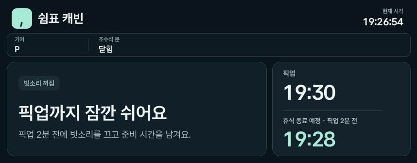
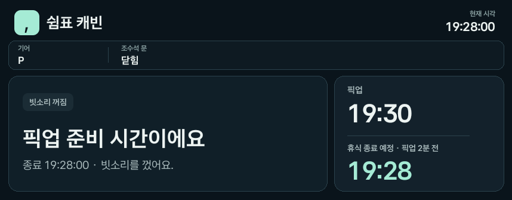
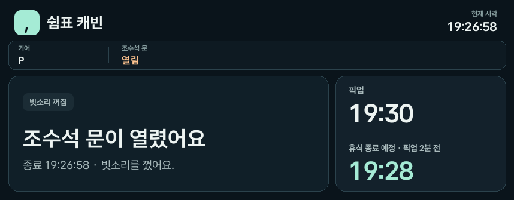

# 쉼표 캐빈 · Comma Cabin

픽업 장소에 일찍 도착한 운전자가 주차한 차에서 빗소리를 들으며 쉬는 Pleos Connect 앱입니다. **19:30 픽업이라면 19:28에 빗소리를 끕니다. 조수석 문이 먼저 열리면 그때 바로 멈춥니다.**

[서명된 APK 받기](https://github.com/hongvincent/comma-cabin/releases/tag/v0.1.0) · [설치와 실행](#설치와-실행) · [에뮬레이터 검증 기록](docs/verification.md)

## Pleos에서 확인한 화면

**휴식 시작 전** · P 기어와 조수석 문 닫힘을 확인하면 시작할 수 있습니다. 픽업 시각과 휴식 종료 시각이 함께 표시됩니다.

[](docs/images/pleos-ready-full.png)

| 픽업 2분 전 종료 | 조수석 문 열림으로 종료 |
| --- | --- |
| [](docs/images/pleos-deadline-full.png) | [](docs/images/pleos-door-full.png) |
| 문을 닫아 둔 시험에서 **19:28:00**에 재생을 멈췄습니다. | 문을 먼저 연 시험에서 **19:26:58**에 재생을 멈췄습니다. |

설치한 release APK의 Pleos 에뮬레이터 화면에서 상태와 시각이 있는 부분을 잘라 배열했습니다. 이미지를 누르면 해당 화면의 전체 캡처를 볼 수 있습니다. 재생과 정지는 [MediaPlayer 로그](docs/verification.md#실측-결과)로 확인했습니다.

## 설치와 실행

| 항목 | 값 |
| --- | --- |
| 앱 | `app.commacabin` · v0.1.0 · 서명된 release APK |
| 설치 파일 | [GitHub Release v0.1.0](https://github.com/hongvincent/comma-cabin/releases/tag/v0.1.0) · [저장소의 APK](apk/쉼표캐빈_쉼표캐빈_release.apk) |
| 검증 환경 | Pleos Connect Emulator **2.1.0** · Android Automotive OS **API 34** · arm64-v8a |
| 디스플레이 | **2560 × 1440** · 160 dpi |
| SDK | Pleos Vehicle SDK **2.3.2** |

[Pleos Connect 에뮬레이터](https://document.pleos.ai/docs/connect/guide/getting-started/application-development/setup-connect-sdk-emulator)를 실행한 뒤 저장소 루트에서 설치합니다. APK만 받은 경우 첫 명령에서 내려받은 파일 경로를 사용하세요.

```sh
adb -e install -r "apk/쉼표캐빈_쉼표캐빈_release.apk"
adb -e shell am start -n app.commacabin/.MainActivity
```

1. [Pleos Virtual Console](https://document.pleos.ai/docs/pleos-only/app-test-guide/virtual-console-guide)을 열어 둡니다. `Motion → Gear Selection → P`와 `Convenience → Door Position → Front Right → Close`를 설정합니다.
2. 앱에서 기어 **P**와 조수석 문 **닫힘**을 확인합니다. 문 상태가 **확인 중**이면 오른쪽 앞문을 한 번 열었다가 닫아 신호를 갱신합니다.
3. **픽업 시각 변경**에서 현재 에뮬레이터 시각보다 4분 이상 뒤를 선택하고 **휴식 시작**을 누릅니다. 정확히 **19:30 → 19:28**을 재현하려면 차량 상태를 확인한 뒤 [에뮬레이터 시계 설정](docs/verification.md#같은-조건에서-실행하기)에 따라 **19:26:30**으로 맞추고 **19:27:00 전에** 시작합니다.

### 재현할 동작

| 경로 | 입력 | 확인할 결과 |
| --- | --- | --- |
| 예정 종료 | 조수석 문을 닫은 채 픽업 2분 전까지 기다립니다. | 빗소리가 꺼지고 **픽업 준비 시간이에요**가 표시됩니다. |
| 조기 종료 | 예정 시각 전에 Virtual Console에서 오른쪽 앞문을 **Open**으로 바꿉니다. | 빗소리가 꺼지고 **조수석 문이 열렸어요**가 표시됩니다. 문을 닫은 뒤에도 자동으로 재생되지 않습니다. |
| 주행 준비 | 휴식 중 P 기어를 D로 바꿉니다. | 빗소리가 꺼집니다. P로 돌아와도 자동으로 재생되지 않습니다. |

시작 및 종료 이유를 앱 로그에서 확인할 수 있습니다.

```sh
adb -e logcat -v threadtime -s CommaCabin:I CabinVehicle:I
```

## 차량 신호와 오디오

| 입력 | 사용 API | 앱 동작 |
| --- | --- | --- |
| 조수석 문 | Pleos Vehicle SDK `Door` · `ROW_1_RIGHT` | 오른쪽 앞문 상태를 조회하고 변경을 구독합니다. 닫힘이 확인될 때만 시작하고, 문이 열리거나 문 신호가 끊기면 종료합니다. |
| 기어와 주행 제한 | Android Automotive `GEAR_SELECTION` · `CarUxRestrictionsManager` | P 기어에서 화면 사용이 허용될 때 시작합니다. P를 벗어나거나 주행 제한이 걸리면 종료합니다. |
| 앰비언트 조명 밝기 | Pleos Vehicle SDK `Light` | 지원 좌석의 밝기 값을 읽으며 운전석을 우선합니다. 휴식 중 앱 창의 밝기에 반영하고, 지원 값이 없으면 시스템 밝기를 사용합니다. |
| 빗소리와 오디오 포커스 | Android `MediaPlayer` · `AudioManager` | 내장 빗소리를 미디어 경로로 반복 재생합니다. 오디오 포커스를 잃거나 앱 화면을 떠나면 종료합니다. |

픽업 시각은 앱에서 직접 설정합니다. 현재 구현 범위는 차량 상태 읽기, 앱 화면 밝기, 미디어 재생입니다. 차량 조명 제어, 서라운드 채널 제어, 내비게이션과 픽업 서비스 연동은 후속 범위입니다. 실차 동작은 별도 검증이 필요합니다.

## 소스 빌드

JDK 17, Android SDK Platform 34, Build Tools 35.0.0을 준비합니다. SDK에 `platforms/android-34/optional/android.car.jar`가 있어야 합니다. Android Studio에서 프로젝트를 열거나 `ANDROID_HOME`을 설정합니다. Gradle 8.10.2 Wrapper와 Android Gradle Plugin 8.8.2를 사용하며, 빌드 시 Pleos Maven 저장소에서 Vehicle SDK를 받습니다.

```sh
./checks/run.sh
./gradlew :app:assembleRelease
```

빌드 결과는 `app/build/outputs/apk/release/app-release-unsigned.apk`에 생성됩니다. 직접 빌드한 APK를 설치하려면 `zipalign`과 `apksigner`로 별도 서명합니다. 심사용 release APK는 서명되어 있습니다.

| 파일 | 역할 |
| --- | --- |
| [RestRules.java](app/src/main/java/app/commacabin/RestRules.java) | 픽업 2분 전 종료, 최소 휴식 1분, 종료 사유 판단 |
| [VehicleSignals.java](app/src/main/java/app/commacabin/VehicleSignals.java) | Pleos Vehicle SDK와 Android Automotive에서 차량 상태 읽기 |
| [MainActivity.java](app/src/main/java/app/commacabin/MainActivity.java) · [CabinScreen.java](app/src/main/java/app/commacabin/CabinScreen.java) | 재생과 정지, 시각 설정, 차량용 화면 |
| [checks/run.sh](checks/run.sh) | Android 없이 실행하는 종료 규칙 검사 |
| [docs/verification.md](docs/verification.md) | 에뮬레이터 실측 시각, 로그, 재현 절차와 APK SHA-256 |
